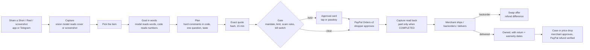

# Everyday flow map

Written 10 Nov 2026 from the code in `src/` and a walk of https://pph-everyday.onrender.com. The redesign keeps every route and service below; only the presentation layer changed.

## Personas

| Persona | Who | How they get in | What they do |
|---|---|---|---|
| **Maya** (shopper) | A busy parent who saves things from Reels, Shorts and TikTok and buys a few of them | `/login` → "Continue as Maya" (demo mode), or an access key | Shares a clip, sets a goal, answers one question, approves an exact quote on PayPal, handles delays, damage and price drops, keeps a record of what she owns |
| **Ari** (gift recipient) | Maya's brother | Not a login: a recipient on Maya's account | Gift plans learn his taste separately and never change Maya's |
| **Northlight Supply** (merchant) | The sandbox test merchant selling the desk catalog | `/login` → "Open merchant console" | Ships, delivers or backorders lines, decides cases, sets prices, attaches tracking, answers disputes, sets its refund mandate |
| **Outside assistant** (agent) | Any MCP client holding Maya's or Northlight's key | `POST /mcp` or `/merchant/mcp` with `Authorization: Bearer` | Plans and quotes for Maya inside her mandate; can never approve a payment; the merchant MCP is read-only |
| **Judge / operator** | Anyone in demo mode | `/judge`, `/demo`, `/console/*`, `/telegram` | Resets the demo, moves the clock, injects PayPal faults, runs evals |

## Screens

Shopper: `/today` · `/discover` · `/captures/:id` · `/plans` · `/plans/:id` · `/purchases` · `/orders/:id` · `/you` · `/guard` (Approvals and limits) · `/passport` · `/safety` (+ `/safety/model-card`) · `/channels` · `/traces` · `/trace/:id`.
Merchant: `/merchant` · `/merchant/money` · `/merchant/approvals` · `/channels` · `/traces`.
Public and operator: `/` · `/login` · `/judge` · `/demo` · `/console` · `/console/evidence` · `/console/eval` · `/telegram` · `/llms.txt` · `/skill.md`.

## State changes

| Entity | States | Moved by |
|---|---|---|
| Capture | `link_saved` → (`analysed_cover` · `analysed_fixture` · `analysed_screenshot` · `described`); object `selected` | Shopper (app or Telegram); vision model for screenshots and public covers |
| Intent (goal) | `planning` → `quoted` → `purchased`; `stale` when the capture's selected object changes | Shopper; planner |
| Plan | versioned; `current` → `superseded` / `ordered` | Planner on every answer, taste choice or add-on |
| Quote | `open` (15 min, hashed over lines, price, stock, plan version, policy, payee) → `approved` / `superseded` / `expired` | Shopper "Get an exact quote" |
| Order | `created` → `paid` (only on a COMPLETED capture of the quoted amount) → lines `ordered` → `shipped` → `delivered`; `backordered`, `swapped`, `returned`; `declined` with PayPal's reason | Shopper approval on PayPal; reconciler; merchant |
| Case | `choose` → `awaiting_merchant` → `approved`/`declined` → `resolved` (only after PayPal confirms the refund) | Shopper opens and picks a remedy; merchant decides; worker verifies |
| Approval (held move) | `pending` → `approved` / `declined` → released by the worker | Gate; shopper or merchant tap; passkey above the countersign line |
| Owned item | `owned` → `sold` / `given` / `recycled` | Delivery, receipt import, mention in a request, manual add |
| Preference model | versioned weights per recipient; receipts; undo replays | Taste choices (gated by reason) |

## Money movements (all PayPal sandbox)

| Moment | PayPal call | Amount from | Who approves |
|---|---|---|---|
| Approve quote / Pay | `POST /v2/checkout/orders` (intent CAPTURE, item breakdown, payee) | The hashed quote | Shopper on the PayPal page |
| PayPal return / reconciler | `POST /v2/checkout/orders/{id}/capture` then `GET /v2/payments/captures/{id}` read-back | The order total; refused if the capture amount or currency differs | Shopper's approval above; code checks status COMPLETED |
| Backorder swap | `POST /v2/payments/captures/{id}/refund` (difference) | Catalog price difference | Shopper taps Swap; gate checks the merchant mandate |
| Case remedy (partial refund, return, price protection) | refund on the original capture, then `GET /v2/payments/refunds/{id}` until COMPLETED | The case's remedy option computed by code from the policy version in the quote | Merchant approves; held above its threshold or ceiling |
| Save PayPal | `POST /v3/vault/setup-tokens` → buyer approves → `POST /v3/vault/payment-tokens` | none | Shopper on PayPal |
| Repeat buy | `POST /v2/checkout/orders` with `payment_source.paypal.vault_id` and capture | Catalog price | Gate: under the threshold runs; at or above waits for a tap; above the countersign line needs a passkey |
| Tracking | `POST /v2/checkout/orders/{id}/track` | none | Merchant |
| Disputes | `GET /v1/customer/disputes`, `provide-evidence`, `accept-claim` | Accept-claim refund is gated | Merchant |
| Reconcile | `GET /v1/reporting/transactions` | none | Merchant |
| Negative tests | refund of 1 cent with `PayPal-Mock-Response` | 1 cent | Merchant (gated) |
| Webhooks | `POST /webhooks/paypal` verified with `/v1/notifications/verify-webhook-signature`; recorded once | none | n/a; PayPal read-back stays the source of truth |

Every write above goes through `src/guard/dryrun.ts` first: kill switches, integer cents, provenance of the amount, the mandate, the monthly limit, the merchant refund ceiling, the scam rules and live PayPal state. `test/structural.test.ts` fails the build if a PayPal write in `src/services` is not preceded by the gate.

## AI calls

| Purpose | Model (tier) | Input | Output | What code does with it |
|---|---|---|---|---|
| `read_request` (new, 10 Nov) | `gpt-5.4-mini` → `gpt-5.5` | The shopper's goal text, instruction-like lines quarantined | Wanted/owned/replaced categories, recipient, deadline weekday, comfort, must-have words, each with a quote | Keeps a field only if its quote is in the text; budget is never read by the model; the weekday becomes a date in code; falls back to the rules parser |
| `capture_frame` | `gpt-5.6-luna` → `gpt-5.5` | An uploaded screenshot, or (new) the public oEmbed cover of a YouTube/TikTok link | Products seen, category, search words, a price seen with its quote, a transcript | Objects become choices; a price is an observation only; on-image instructions are quarantined |
| `compile_policy` | `gpt-5.5` | The mandate in plain words | Rules (caps, thresholds, merchants, categories) | Clamped and versioned; regex compiler without a key; backtested before adoption |
| In-browser scam model | MiniLM int8 ONNX in the shopper's browser | A pasted message | A scam score | Advisory only; never reaches the gate |
| Payment-risk model | LightGBM walked in TypeScript (synthetic training) | Order features | A risk score | Shown beside the rule reasons; rules decide |
| Preference model | Pairwise logistic, trained offline + online updates | Explicit this-or-that choices | Weights | Ranks eligible products; hard constraints are code |

## Channels

Telegram (live bot on Render; `/c/telegram/webhook` and `/webhooks/telegram`, secret-token checked) for sharing links, approvals with buttons, delays and price drops; web push (VAPID set on Render); the in-app message simulator at `/channels`; the Telegram simulator at `/telegram`. WhatsApp is not configured.

## Main journey

